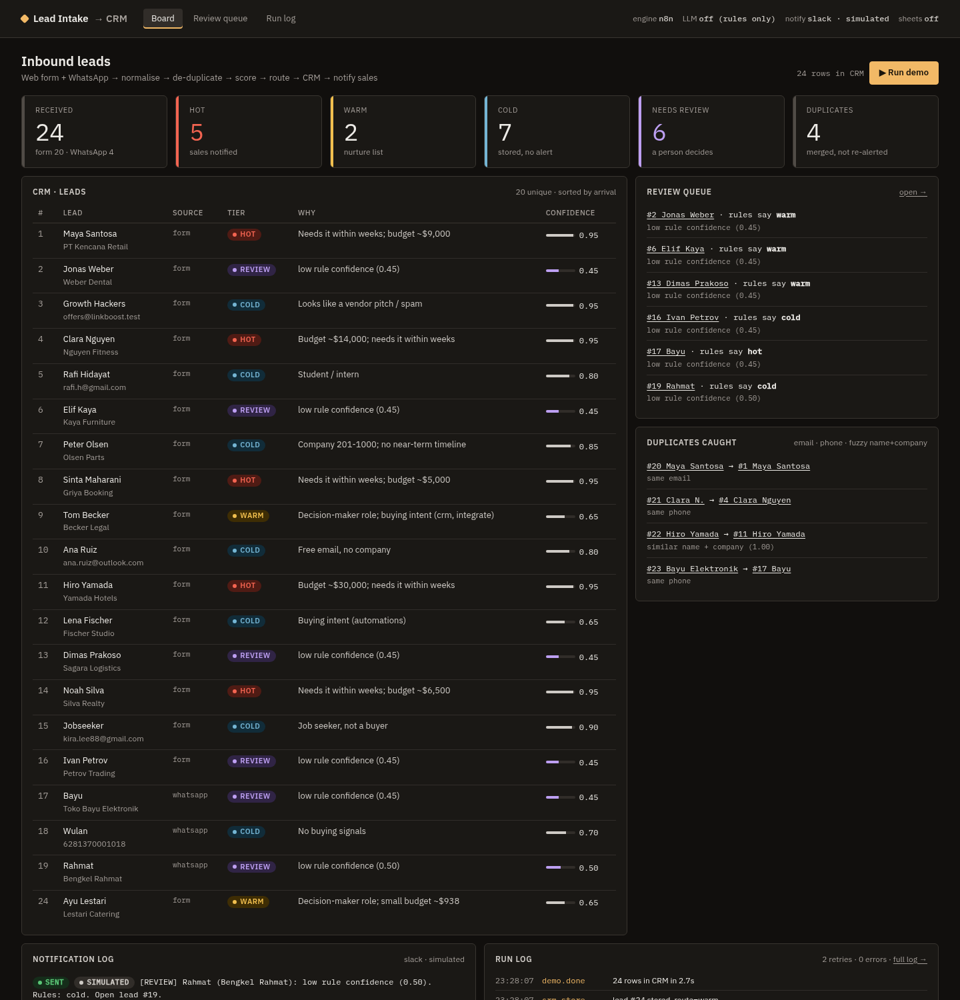
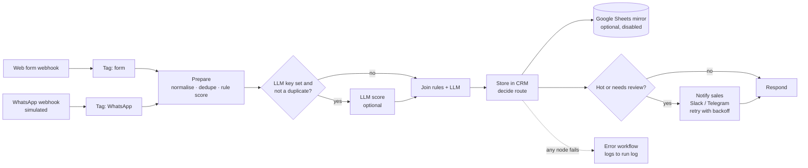
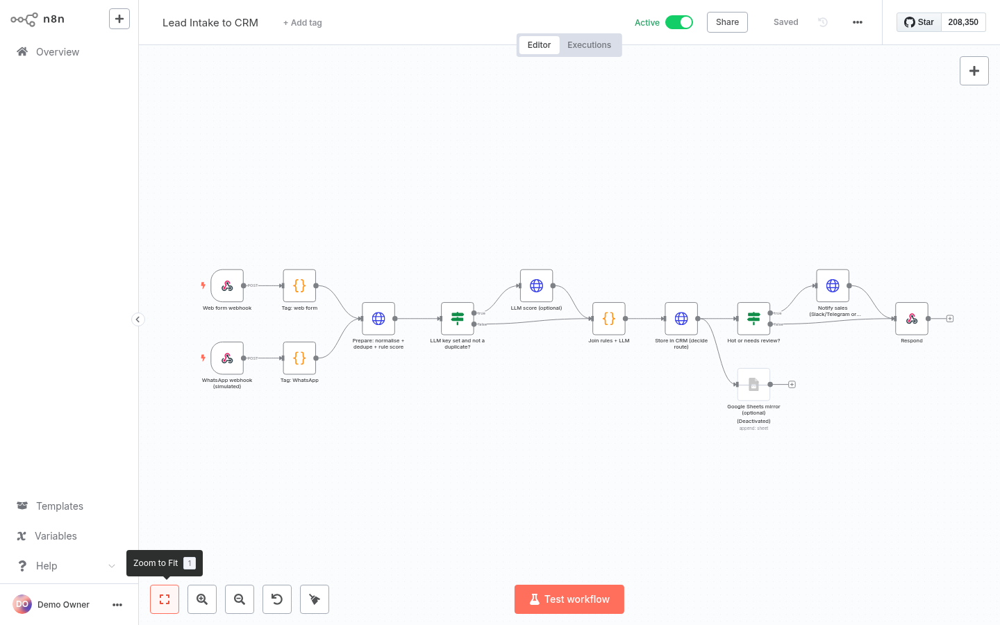
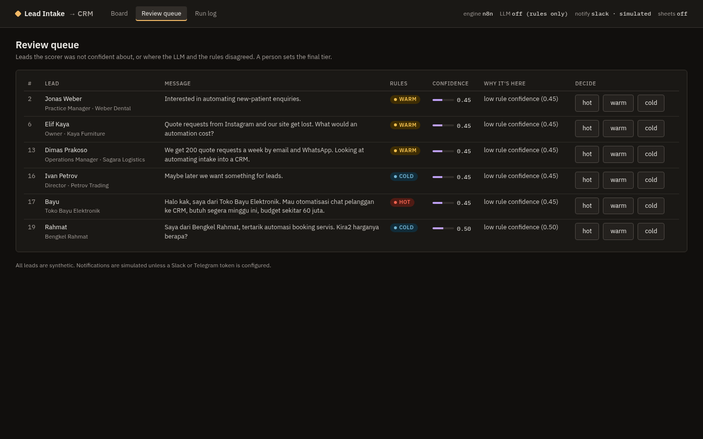
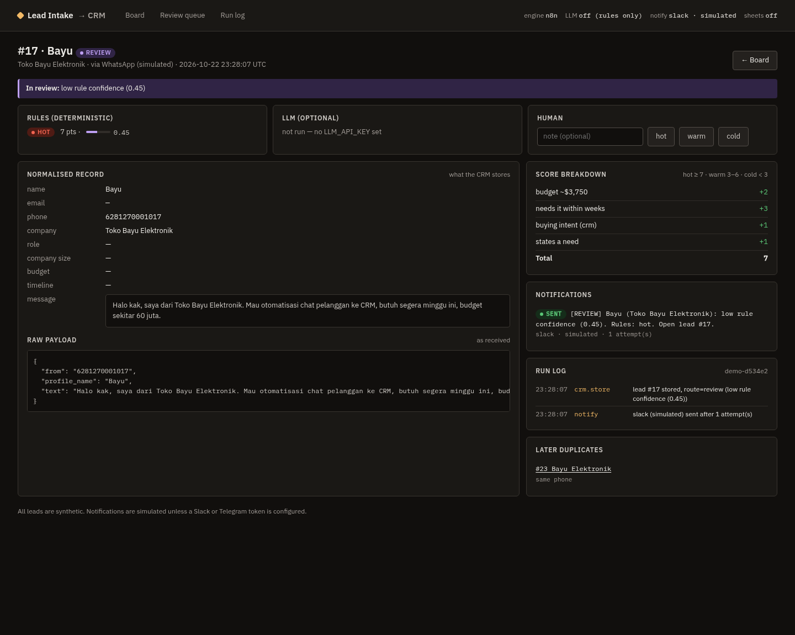

# Lead Intake to CRM

**Live demo (one click, no install):** https://huggingface.co/spaces/Anggittaba/lead-intake-crm  
Browser version of the same rules on the same 24 synthetic leads (`web/`, checked against the Python engine by `tests/test_web_demo.py`). The full n8n + FastAPI version is this repo.

An n8n workflow plus a small FastAPI CRM that takes inbound leads from a web form and a (simulated) WhatsApp
webhook, cleans them up, catches duplicates, scores them hot / warm / cold with a one-line reason, sends unclear
ones to a person, stores everything in SQLite and pings sales about the leads worth a call.

One click runs it: start the app, press **Run demo**, and 24 synthetic leads go through the whole pipeline.



## The problem

Small teams get leads from several places: a website form, WhatsApp, sometimes the same person through both.
Typical mess:

- the same person arrives twice (`maya@x` on the form, then `+62 813…` on WhatsApp), and sales calls them twice;
- spam, vendor pitches and job seekers land in the same inbox as real buyers;
- the one lead with budget and a deadline waits behind twenty others;
- when a notification API is down, the alert is silently lost.

## What it does



Routes a lead can take:

| Route | When | What happens |
|---|---|---|
| duplicate | same email, same phone, or similar name + company (fuzzy ≥ 0.85 / 0.80) | linked to the original, no second alert |
| review | rule confidence < 0.6, or the LLM and the rules disagree | waits in the review queue; a person picks the tier |
| hot | score ≥ 7 and (urgent timeline or budget ≥ $3k) | stored + sales notified |
| warm | score 3–6 | stored, no alert |
| cold | score < 3, spam, job seekers | stored, no alert |

## Who decides what: AI vs rules vs human

| | Rules (always on) | LLM (optional) | Human |
|---|---|---|---|
| Normalising email / phone / company | ✓ | | |
| Duplicate detection | ✓ (exact + fuzzy) | | |
| Tier + one-line reason | ✓ deterministic, explainable points | second opinion if `LLM_API_KEY` is set | |
| Unclear or conflicting leads | flags them | flags disagreement | ✓ sets the final tier |
| Sending alerts | ✓ hot leads and review items | | |

The rules are the default and the fallback: if the LLM call fails or times out, the rule result is used. The
LLM path is implemented (any OpenAI-compatible endpoint) but **was not run for the numbers below**; there was
no API key on the build machine.

## Measured numbers

All leads are synthetic. **I wrote the leads, the labels and the rules myself**, so these numbers show how the
rules behave on my test data, not on real traffic. Reproduce with `python -m leadcrm.evaluate`
(writes `docs/results.json`).

| Set | Leads | Correct tier | Auto-routed (no human) | Correct among auto-routed | Sent to review |
|---|---|---|---|---|---|
| Generated dev set (rules were tuned on it) | 150 | 148 (98.7%) | 121 | 121 (100%) | 29 (19.3%) |
| **Handwritten held-out set** | **40** | **32 (80.0%)** | **31** | **26 (83.9%)** | **9 (22.5%)** |

The held-out number is the honest one. The dev set is generated from templates similar to the rules, so its
score is inflated. One caveat even on held-out: I made one tuning round after seeing the aggregate held-out
score (not individual items), so treat 80% as optimistic.

Most held-out mistakes are warm leads scored cold (3 of 8) and warm leads scored hot (2 of 8).

Duplicates: 4/4 planted duplicates caught in the demo batch, 0 false matches across 190 non-duplicate leads.

Demo run (24 leads, same result through n8n and through the built-in engine): 5 hot, 2 warm, 7 cold,
6 to review, 4 duplicates, 11 notifications, 2 retries (one alert is made to fail twice with a simulated 503
and succeeds on the third try).

No time-saved figures are claimed; nothing here was measured against a real team.

## Screens

| n8n workflow | Review queue | Lead detail |
|---|---|---|
|  |  |  |

## How to run

### One command (built-in engine, no n8n)

```bash
./scripts/demo.sh          # venv, install, tests, then http://127.0.0.1:8830
```

Press **Run demo**. The built-in engine runs exactly the same steps as the n8n workflow by calling the same
`/api/steps/*` endpoints in-process.

### With real n8n

```bash
./scripts/run_with_n8n.sh  # installs n8n 1.85.4 locally, imports + activates both workflows, starts both apps
```

Or by hand in any n8n 1.x:

1. Import `workflows/lead-intake-error-handler.json`, then `workflows/lead-intake-to-crm.json`.
2. Set `CRM_BASE_URL` in n8n's environment to where this app runs (e.g. `http://127.0.0.1:8830`).
3. Activate the main workflow (its settings already point to the error workflow).
4. Start the app with `N8N_WEBHOOK_URL=http://127.0.0.1:5678/webhook python -m leadcrm`; **Run demo** now
   posts each lead to the n8n webhooks (`/webhook/lead-form`, `/webhook/lead-whatsapp`).

Tested with n8n 1.85.4 (npm install of the newest 1.x failed on this machine building `isolated-vm`).

### Docker / hosting (online demo, built-in engine)

```bash
docker build -t lead-intake-crm . && docker run -p 7860:7860 lead-intake-crm
```

`render.yaml` (Render blueprint) and `deploy/huggingface/README.md` (Docker Space header) are included.
Nothing is deployed.

### Configuration

See `.env.example`. Everything is optional: no keys means rules-only scoring, simulated notifications
(logged on the board), no Sheets mirror.

### Tests

```bash
.venv/bin/python -m pytest -q   # 28 tests
```

## Project layout

```
leadcrm/        normalize, dedupe, scoring (rules + optional LLM), pipeline, notify (retry), store (SQLite), app
workflows/      n8n exports: main workflow + error workflow (generated by scripts/build_workflow.py)
data/           demo batch (24), generated dev set (150), handwritten held-out set (40)
tests/          unit + API tests
scripts/        demo.sh, run_with_n8n.sh, screenshots, demo video
```

## Limitations

- Synthetic data only, written by me; real leads will be messier (voice notes, images, other languages).
- WhatsApp is simulated: the webhook accepts a simplified `{from, profile_name, text}` payload, not the Meta Cloud API format.
- Rules are tuned for English and some Indonesian phrasing; budget parsing handles `$`, `k`, `Rp` and `juta` only.
- The fuzzy duplicate check compares against every stored lead (fine for thousands, not millions).
- n8n quirk: an HTTP node with *Retry on fail* treats a JSON response that has an `error` key as a failure and
  retries it, even on HTTP 200. The notify endpoint therefore never returns an `error` key on success.
- When a step fails after all retries, the n8n webhook returns an empty response (the error workflow logs it).
- The Google Sheets mirror is a disabled node that needs your own Apps Script URL; it was not tested against Google.
- The LLM scoring path was not run against a real model.

## License

MIT
